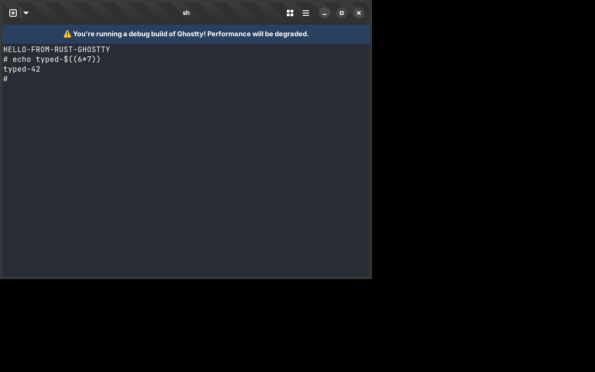

# ghostty-rs

A file-for-file port of the [Ghostty](https://github.com/ghostty-org/ghostty)
terminal emulator from Zig to Rust (reference revision `93967b7`).



Every `ghostty/src/**/*.zig` (and `ghostty/pkg/**/*.zig`) file has a Rust
counterpart at the mirrored snake_case path, e.g. `src/terminal/PageList.zig`
→ `src/terminal/page_list.rs`, with its tests ported alongside. See
[PORTING.md](PORTING.md) for the conventions and `PORTING_STATUS.tsv` for the
full file mapping.

## Building and running (Linux)

System libraries: GTK 4, libadwaita, FreeType, HarfBuzz, fontconfig,
Oniguruma, EGL/GL. On Debian/Ubuntu:

```sh
sudo apt install libgtk-4-dev libadwaita-1-dev libfreetype-dev libharfbuzz-dev \
  libfontconfig-dev libonig-dev libegl-dev
cargo run --release              # the GTK terminal
cargo run --release -- +version  # CLI actions work as in Ghostty
cargo test --lib                 # the ported test suite
```

`cargo build --no-default-features` builds without the GTK runtime.
`--features inspector` enables the Dear ImGui terminal inspector.
`ghostty-bench` and `ghostty-gen` are the benchmark and synthetic-data tools.

## Progress

```sh
python3 tools/status.py      # summary
python3 tools/status.py -v   # per file
```

Each Rust file's header says `STATUS: ported`, `partial — ...`, or
`not yet ported`. macOS code (Metal, CoreText, the embedded apprt) is ported
and type-checks with `cargo check --target x86_64-apple-darwin`, but has not
been run.

## Working with the reference source

```sh
git clone https://github.com/ghostty-org/ghostty.git ghostty
git -C ghostty checkout 93967b7f9478e94dcbb42125c8a90f34feb40d75
```
